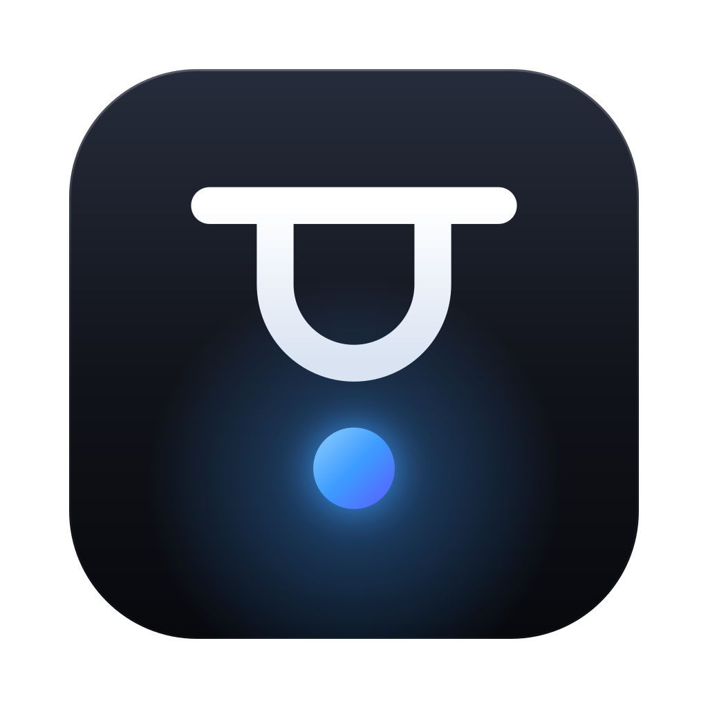
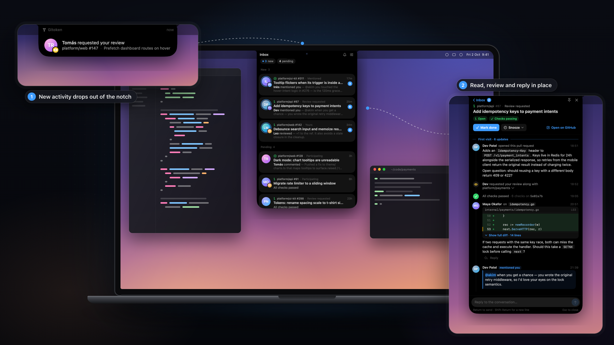
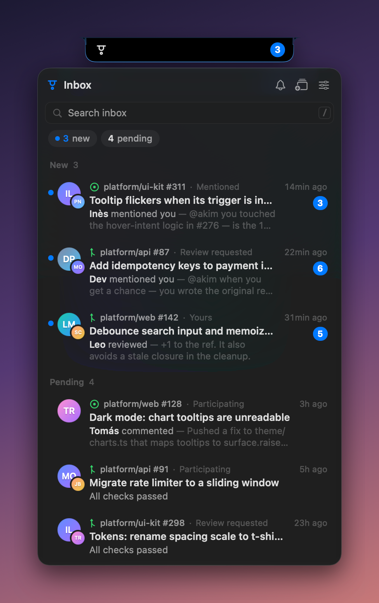
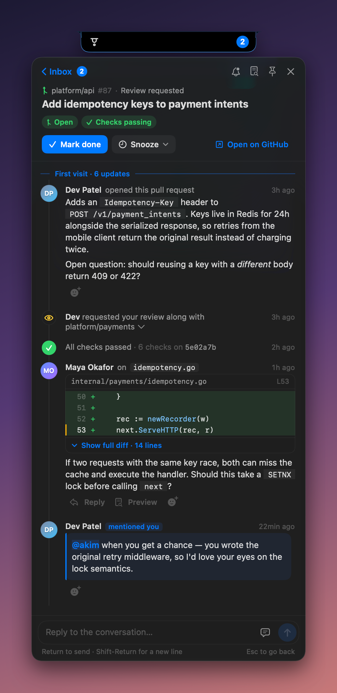
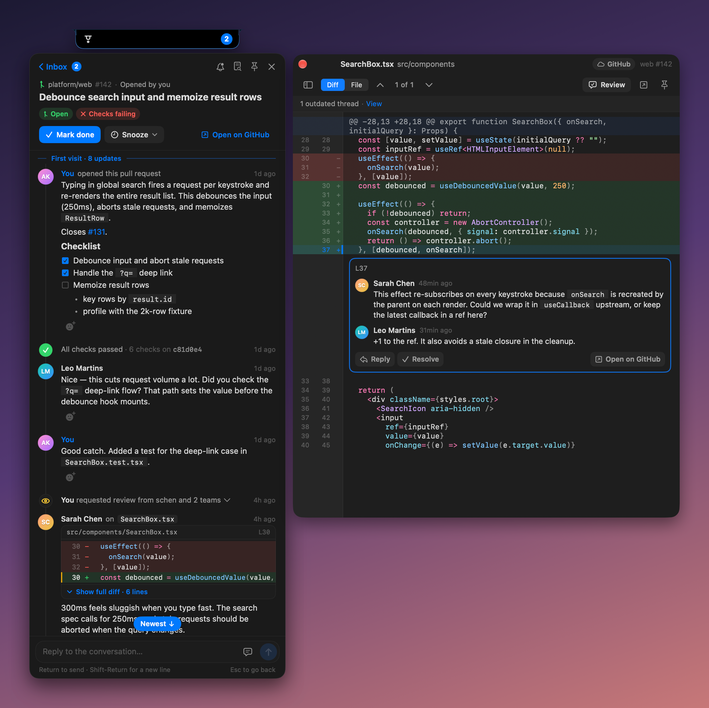
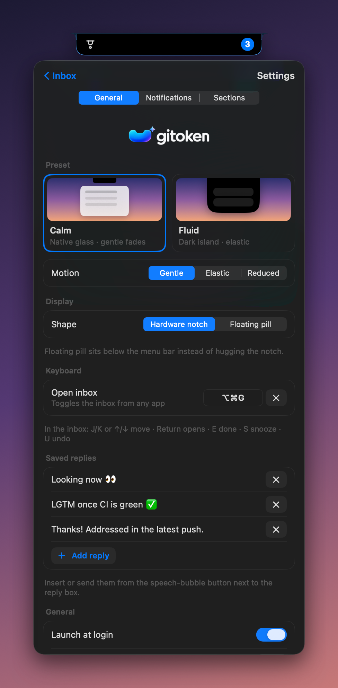

<p align="center">
  
</p>

<h1 align="center">Gitoken</h1>

<p align="center">GitHub notifications that live in your MacBook's notch.</p>

<p align="center">
  
</p>

Gitoken is a native macOS menu-bar app. New GitHub activity drops out of the notch. Click it to triage your inbox, read the conversation, and review code without opening a browser.

- **Arrivals from the notch.** The avatar of whoever caused the activity, a status-lit rim and an optional subtle sound. Bursts on the same PR merge into one arrival.
- **Inbox grouped by PR or issue.** Unread, pending and done map to GitHub's read and done states. Search with `/` using `repo:`, `author:`, `reason:` and `is:`.
- **Conversations in place.** Timeline, review comments with their diff hunks, check status and rich Markdown. Reply, react, mark done or snooze.
- **File preview and review mode.** Open a review comment to see the file or diff with every thread inline. Comment on lines, batch suggestions, then approve or request changes.
- **Custom sections.** Saved GitHub searches shown above the inbox.
- **PR readiness alerts.** Monitor a PR and get a green glow when checks and approvals are done.
- **Calm by default.** Quiet hours, snooze, mute rules, and hiding AI-reviewer noise (Copilot, CodeRabbit, …).

Everything is keyboard-driven (`⌥⌘G` opens the inbox). See [docs/FEATURES.md](docs/FEATURES.md) for the full reference.

## Screenshots

| Inbox | Conversation |
| --- | --- |
|  |  |
| **File preview with inline review threads** | **Settings** |
|  |  |

<sub>All screenshots use the app's built-in fictional demo data.</sub>

## Install

Requires macOS 15 or later and the [GitHub CLI](https://cli.github.com) signed in to github.com. Gitoken reuses its token and has no login of its own.

```sh
brew install gh && gh auth login
brew install --cask benzara-tahar/tap/gitoken
```

Release zips are also on the [Releases page](https://github.com/benzara-tahar/gitoken/releases).

Gitoken is ad-hoc signed, not notarized, so macOS blocks the first launch. Click **Open Anyway** in System Settings › Privacy & Security, or run:

```sh
xattr -dr com.apple.quarantine /Applications/Gitoken.app
```

Gitoken has no Dock icon. Look for it at the notch, or as a pill at the top of the screen on Macs without one.

## Privacy

Gitoken talks only to the GitHub API using your `gh` token. It has no server, analytics or telemetry. Notification state is cached locally in SQLite.

## Build from source

Requires Xcode 26.

```sh
xcodebuild -project Gitoken.xcodeproj -scheme Gitoken -configuration Debug \
  -derivedDataPath build/DerivedData build
open build/DerivedData/Build/Products/Debug/Gitoken.app --args --fixtures   # demo data, no GitHub login
```

Tests, packaging, architecture and releases are covered in [BUILD.md](BUILD.md).

## License

[MIT](LICENSE). Bundled tree-sitter queries are MIT licensed by their authors; see their [NOTICE](Packages/GitokenCore/Sources/GitokenCore/Preview/Queries/NOTICE).
